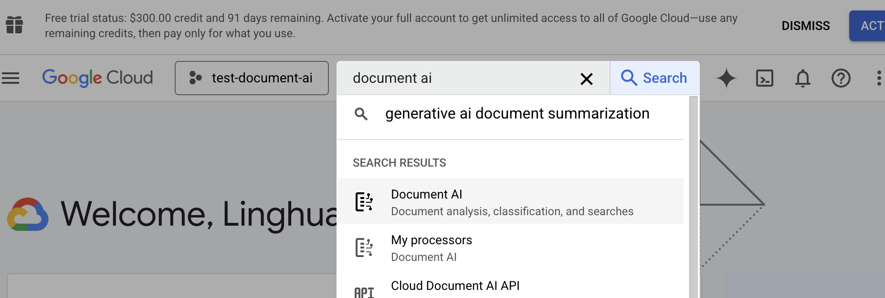
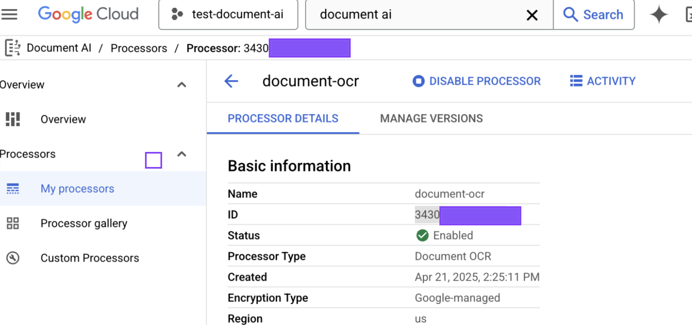

# 🥥 CocoIndex ETL with Document AI

[CocoIndex](https://cocoindex.io) is an ETL framework to transform data for AI, with real-time incremental processing — keep your index up to date with low latency on source updates. It supports custom logic like LEGO, making it easy to plug in the modules that best suit your project.

This example builds an embedding index from local PDF files, using [Google Document AI](https://cloud.google.com/document-ai?hl=en) as the parser. The pipeline walks a folder of PDFs, parses each one with Document AI, chunks the text, embeds it, and stores everything in Postgres/pgvector — then lets you query it semantically.

🥥 🌴 We are constantly improving — more blogs and examples coming soon. Stay tuned 👀 and **drop a star at [CocoIndex on GitHub](https://github.com/cocoindex-io/cocoindex)** for the latest updates!
[](https://github.com/cocoindex-io/cocoindex)


## Prerequisites

- **Python 3.11+**
- **Postgres with pgvector** — [install Postgres](https://cocoindex.io/docs/getting_started/installation#-install-postgres) if you don't have one.
- **A Google Document AI processor:**
    - Follow the [official Document AI quickstart](https://cloud.google.com/document-ai/docs/try-docai).
    - Sign in to the [Google Cloud Console](https://console.cloud.google.com/), create or open a project, and enable the Document AI API.
      
    - Create a processor in Document AI.
      
    - Authenticate locally so the client can pick up credentials: `gcloud auth application-default login`.

## Run

Install dependencies:

```bash
pip install -e .
```

Create your `.env` from the template and fill in your values:

```bash
cp .env.example .env
```

Set `GOOGLE_CLOUD_PROJECT_ID`, `GOOGLE_CLOUD_PROCESSOR_ID`, and (if not `us`) `GOOGLE_CLOUD_LOCATION`. `POSTGRES_URL` points at your pgvector database, and `COCOINDEX_DB` is the local engine state path.

Build the index — parse each PDF with Document AI, chunk, embed, and write to Postgres:

```bash
cocoindex update main.py
```

Run it incrementally as files change (live mode watches the source dir):

```bash
cocoindex update -L main.py
```

Re-runs only reprocess files that actually changed, and the (paid) Document AI parse is memoized by file content — so editing chunking or embedding settings won't re-bill the API for unchanged PDFs.

## Query

Run a one-off semantic search:

```bash
python main.py "what is multi-head attention?"
```

Or start an interactive prompt:

```bash
python main.py
```

## How it works

The pipeline lives in [`main.py`](./main.py):

- `pdf_to_markdown` — a memoized `@coco.fn` that parses each PDF with the Document AI async client (so the paid call isn't repeated for unchanged content).
- `process_file` — reads each file, parses, chunks with `RecursiveSplitter`, and maps over chunks.
- `process_chunk` — embeds the chunk with a SentenceTransformer model and declares a row in the Postgres `TableTarget`.

Because every file is an independent component and the parse + embed steps are memoized, re-runs only touch what changed.
